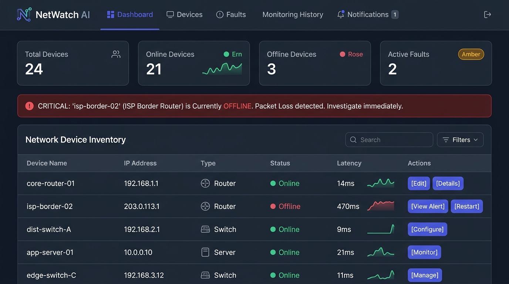
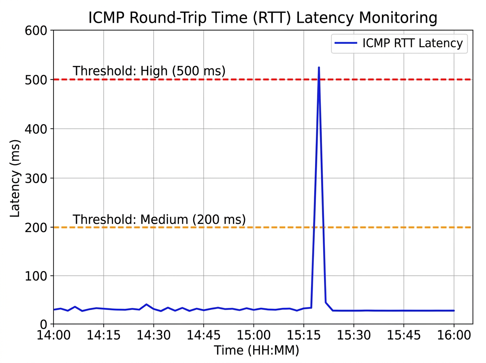
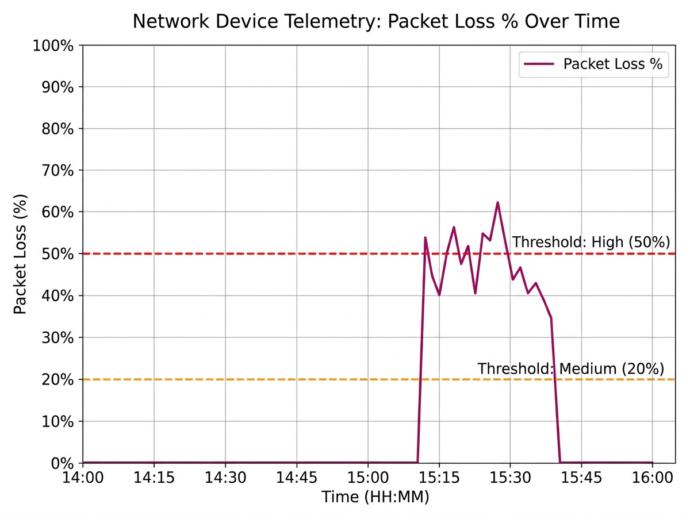
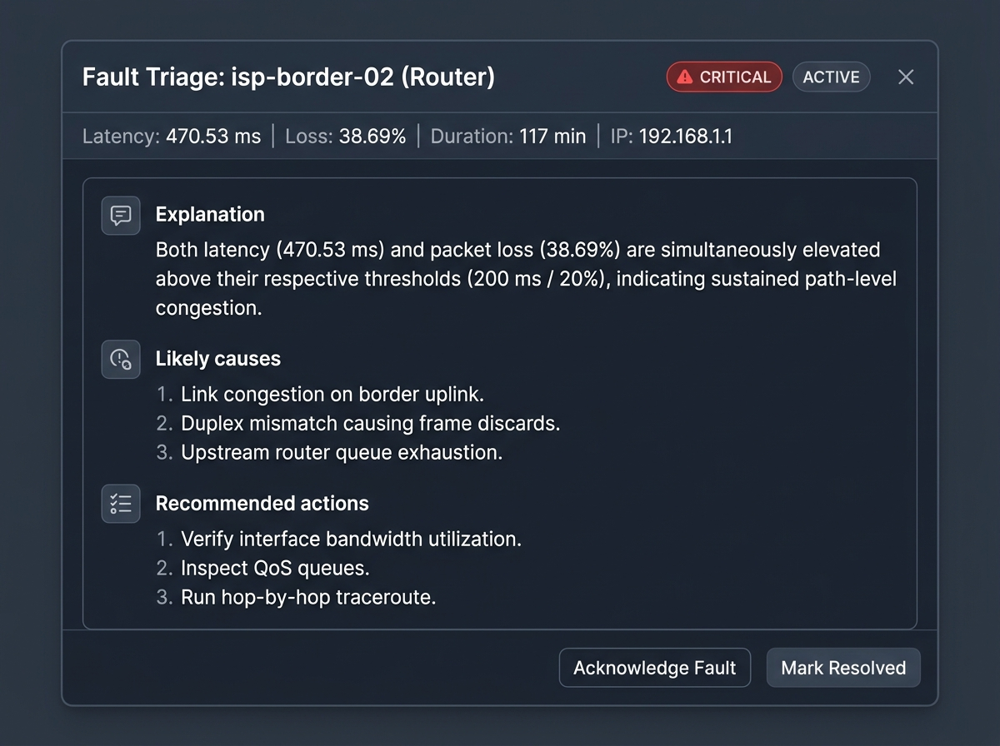
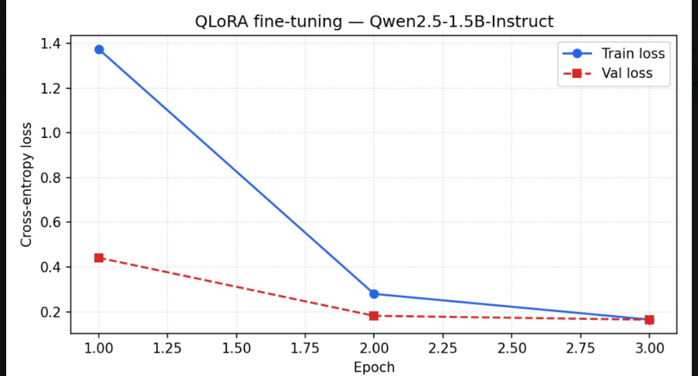

# Intelligent Network Device Monitoring and Fault Detection System with Domain-Specific QLoRA LLM Triage

[](https://www.python.org/)
[](https://www.djangoproject.com/)
[](https://react.dev/)
[](https://tailwindcss.com/)
[](https://huggingface.co/Qwen/Qwen2.5-1.5B-Instruct)
[-orange.svg)](https://github.com/huggingface/peft)
[](LICENSE)

An intelligent, full-stack AIOps platform that unifies real-time asynchronous network device monitoring (**ICMP**, **SNMP v1/v2c**, and **HTTP**) with a domain-adapted, instruction-tuned **Large Language Model (Qwen2.5-1.5B-Instruct via QLoRA)** to automate incident triage, root-cause diagnosis, and actionable remediation recommendations.

---

## Academic Project & IEEE Report

* **Institution:** Department of Computer Engineering, Fr. Concei\c{c}\~ao Rodrigues College of Engineering (CRCE), Mumbai, India
* **Team Members:**
  * Jeet Chavan (10584)
  * Zeon Dsouza (10598)
  * Dhruv Dsouza (10597)
  * Delisha Duarte (10599)
* **Academic Paper Source:** [`paper.tex`](paper.tex) / [`miniproject report.tex`](miniproject%20report.tex) *(IEEE Conference Format, Double-Column)*

---

## System Dashboard & Visual Overview

### 1. Web Operator Dashboard
Real-time device reachability, health status cards, active critical alarm notifications, and network inventory controls.



---

### 2. Real-Time Telemetry & Metric Trends
Asynchronous polling engine capturing ICMP round-trip latency spikes and packet loss disruptions visualized via Recharts.

| (a) ICMP RTT Latency Spike (ms) | (b) Packet Loss Percentage (%) |
| :---: | :---: |
|  |  |

---

### 3. AI-Powered Incident Triage Modal
When an anomaly triggers a fault, the fine-tuned LLM generates a structured 3-part diagnostic report directly inside the operator console.



---

### 4. Actual QLoRA Fine-Tuning Loss Convergence
Actual Google Colab training results over 3 epochs on `Qwen2.5-1.5B-Instruct` using 4-bit NF4 quantization. Cross-entropy training loss converged from **1.37 to 0.16** (88.3% reduction) with validation loss dropping from **0.44 to 0.16**.



---

## Architecture

```text
                        Browser
                           │
                   React 19 / TypeScript
                           │ (REST / JSON)
                           ▼
                  Django 5 REST API
                           │
         ┌─────────────────┼─────────────────┐
         │                 │                 │
    SQLite Database  Celery Beat       Celery Workers
 (Faults & Metrics)  (Scheduler)             │ (Redis Broker)
         │                 │                 ▼
         │                 └───────► Probing Subsystem
         │                           ├── ICMP Ping (RTT & Loss)
         │                           ├── SNMP v1/v2c (CPU & RAM)
         │                           └── HTTP Probe (Status & Latency)
         │                                   │
         ▼ (Fault Event Trigger)             ▼ (Metric Telemetry)
  QLoRA LLM Inference Engine <───────────────┘
   (Qwen2.5-1.5B-Instruct)
         │
         ▼
 Structured Triage Report
 (Explanation • Causes • Actions) ──► Saved to DB ──► Pushed to Dashboard
```

---

## Key Features

### 1. Multi-Protocol Telemetry Probing
* **ICMP Ping:** High-precision round-trip time ($T_{\text{rtt}}$) measurement and packet loss percentage ($L_{\%}$).
* **SNMP v1/v2c Polling:** Live OID collection for system CPU utilization and RAM occupancy.
* **HTTP Endpoint Probing:** Response status code verification ($2xx/3xx$) and timeout latency tracking ($T_{\text{resp}} < 5.0\text{s}$).

### 2. Deterministic Fault State Machine
* **Lifecycle:** $\text{Active} \xrightarrow{\text{Admin Ack}} \text{Acknowledged} \xrightarrow{\text{Metric Recovery / Manual}} \text{Resolved}$
* **Threshold Rules:**
  * **Latency:** Medium ($200 \le T_{\text{rtt}} < 500\text{ ms}$), High ($T_{\text{rtt}} \ge 500\text{ ms}$).
  * **Packet Loss:** Medium ($20 \le L_{\%} < 50\%$), High ($L_{\%} \ge 50\%$).
  * **Unreachable:** Triggered on $k_{\text{fail}} \ge 3$ consecutive ICMP echo timeouts.
  * **Resources:** High ($\ge 80\%$), Critical ($\ge 90\%$).
* **Auto-Resolution:** Active faults automatically transition to `Resolved` once consecutive probes return within safe operating limits.

### 3. NLP Curriculum & Dataset Engineering
* **Linguistic Preprocessing:**
  * **Regular Expressions (`re` module):** Strict IPv4 validation with `^(\d{1,3}\.){3}\d{1,3}$`, numerical duration/metric extraction with `re.search()`, multi-metric anomaly parsing with `re.findall()`, lookbehind sentence tokenization with `re.split(r"(?<=[.!?])\s+", text)`, and text sanitization with `re.sub()`.
  * **Tokenization:** Rule-based sentence and word tokenization contrasted against Byte-Pair Encoding (BPE) subword tokenization.
  * **Stemming & Lemmatization:** Porter Stemmer and WordNet POS-aware lemmatization (*drops*, *dropped*, *dropping* $\to$ *drop*; *congested*, *congestion* $\to$ *congest*) to enforce lexical diversity and eliminate semantic cross-split duplicates in `validate_dataset.py`.
* **Dataset Splits (830 Total Records):**
  * **Train Split:** 664 records (80%)
  * **Validation Split:** 85 records (10%)
  * **Test Split:** 81 records (10%)
  * **Out-of-Domain (OOD) Test Set:** 20 stress-test compound fault records.

### 4. QLoRA LLM Fine-Tuning Pipeline
* **Base Model:** `Qwen/Qwen2.5-1.5B-Instruct`
* **Quantization:** 4-bit NormalFloat (NF4) with double quantization via `bitsandbytes`.
* **Adapter Architecture:** LoRA rank $r = 16$, scaling factor $\alpha = 32$, dropout $0.05$, targeting all linear projection modules (`q_proj`, `k_proj`, `v_proj`, `o_proj`, `gate_proj`, `up_proj`, `down_proj`).
* **Supervised Fine-Tuning (SFT):** TRL `SFTTrainer` with completion-only prompt-loss masking.
* **Trained Model Weights:** Saved directly in [`llm/outputs/adapter/`](llm/outputs/adapter/) (`adapter_model.safetensors`, 73.9 MB).

---

## Repository Structure

```text
nlp-miniproject/
├── backend/                        # Django 5 REST backend & Celery monitoring engine
│   ├── backend/                    # Settings, WSGI, Celery configuration
│   └── network/                    # Models, Probes (ICMP, SNMP, HTTP), Fault engine, API
├── frontend/                       # React 19 + TypeScript + Vite + Tailwind CSS v4
│   └── src/                        # Dashboard, device inventory, history, faults UI
├── llm/                            # Applied NLP Subsystem
│   ├── data/                       # train.jsonl, val.jsonl, test.jsonl, ood_test.jsonl
│   ├── outputs/adapter/            # Trained QLoRA adapter weights (safetensors & config)
│   ├── scripts/                    # generate_scenarios.py, build_dataset.py, validate_dataset.py
│   ├── train_lora.py               # Hugging Face TRL QLoRA training pipeline
│   └── train_lora.ipynb            # Google Colab T4 GPU fine-tuning notebook
├── figures/                        # Publication figures & high-res dashboard screenshots
├── docs/                           # Architecture specs, database models, thesis chapters
├── deploy/                         # Nginx and systemd deployment templates
├── paper.tex                       # IEEE double-column conference report source
├── miniproject report.tex          # LaTeX project report source
├── start.md                        # Quick developer runbook
└── README.md                       # Master documentation
```

---

## Quick-Start Guide

### Prerequisites
* Python 3.12+
* Node.js v20+ & npm
* Redis server

---

### Step 1: Backend Setup

```bash
cd backend
python3 -m venv env
source env/bin/activate       # On Windows: env\Scripts\activate
pip install -r requirements.txt
python manage.py migrate --noinput
python manage.py createsuperuser
python manage.py runserver
```
API endpoint: `http://127.0.0.1:8000/api/health/`

---

### Step 2: Background Monitoring (Celery & Redis)

In separate terminal tabs:

```bash
# Terminal A: Start Redis
redis-server

# Terminal B: Start Celery Worker
cd backend
source env/bin/activate
python -m celery -A backend worker -l info

# Terminal C: Start Celery Beat Scheduler
cd backend
source env/bin/activate
python -m celery -A backend beat -l info
```

---

### Step 3: Frontend Dashboard

```bash
cd frontend
npm install
npm run dev
```
Open your browser at `http://localhost:5173` (Login using your superuser credentials).

---

### Step 4: NLP Dataset Validation & LLM Fine-Tuning

```bash
# 1. Validate dataset integrity, headers, and regex constraints
python llm/scripts/validate_dataset.py

# 2. Run QLoRA training locally (requires CUDA GPU; alternatively run llm/train_lora.ipynb on Google Colab)
python llm/train_lora.py
```

---

## Evaluation Results

| Metric | Zero-Shot Baseline | Fine-Tuned QLoRA Adapter | Relative Gain |
| :--- | :---: | :---: | :---: |
| **Structural Output Compliance** | 58.0% | **100.0%** | $+42.0\%$ |
| **Out-of-Domain Compliance (OOD)** | 45.0% | **100.0%** | $+55.0\%$ |
| **BLEU-4 Score (Overall)** | 0.09 | **0.38** | $\approx 4.2\times$ |
| **ROUGE-L Score (Overall)** | 0.21 | **0.54** | $\approx 2.6\times$ |
| **Final Cross-Entropy Loss** | 2.14 | **0.16** | $-88.3\%$ error reduction |

---

## Citation & Academic Reference

If using this implementation or dataset in academic coursework, cite as follows:

```bibtex
@inproceedings{chavan2026netwatch,
  title     = {Intelligent Network Device Monitoring and Fault Detection System with Domain-Specific QLoRA LLM Triage},
  author    = {Chavan, Jeet and Dsouza, Zeon and Dsouza, Dhruv and Duarte, Delisha},
  booktitle = {Proceedings of the Computer Engineering Mini-Project Conference},
  institution={Fr. Concei\c{c}\~ao Rodrigues College of Engineering},
  year      = {2026},
  address   = {Mumbai, India}
}
```

---

## License
This project is licensed under the MIT License — see the [LICENSE](LICENSE) file for details.
